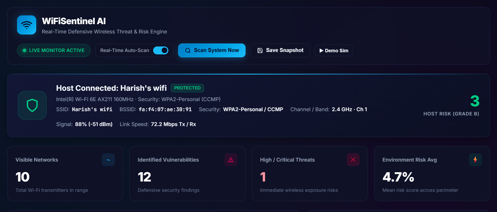
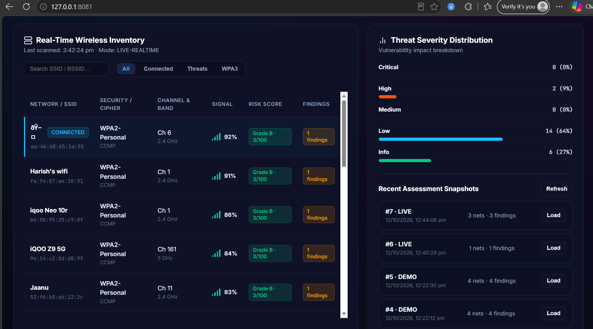
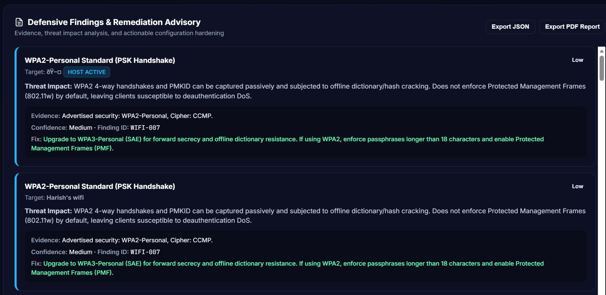
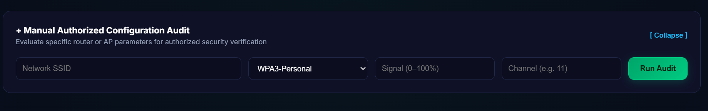

# 🛡️ WiFiSentinel AI — Real-Time Wireless Threat & Risk Engine

[](https://fastapi.tiangolo.com)
[](https://python.org)
[](#platform-support)
[](#defensive-security-scope)
[](#reporting--export)
[](LICENSE)

**WiFiSentinel AI** is a state-of-the-art, defensive, local-first Wi-Fi security assessment engine and real-time perimeter monitoring dashboard. It combines OS-level wireless metadata collection (native **Windows `netsh`** and **Linux `nmcli`**), evidence-based cryptographic rule auditing, automated Evil-Twin / Rogue AP detection, host security posture analysis, and real-time Server-Sent Events (SSE) telemetry.

---

## 📸 Visual Dashboard Tour

### 1. Security Command Center & Host Posture
Monitor your wireless perimeter in real time. The executive dashboard displays real-time telemetry from your wireless interface, connection speed, cryptographic grade, live transmitter count, and calculated environment exposure scores.



> **Key Metrics Highlighted:**
> - **Active Host State:** Identifies active interface (`Wi-Fi 6E AX211`), associated BSSID, physical frequency band (2.4 GHz / 5 GHz / 6 GHz), and connection security posture.
> - **Host Risk Score:** Real-time risk grading (**Grade A–F**) evaluated against handshake risks, encryption downgrades, and cipher vulnerabilities.
> - **Perimeter Exposure KPIs:** Visible network transmitters, identified vulnerabilities, immediate critical threats, and mean perimeter risk score.

---

### 2. Real-Time Wireless Inventory & Threat Severity Matrix
Continuously audit all wireless access points broadcasting within radio range, indexed by RSSI signal strength, encryption suite, and automated risk scoring.



> **Key Capabilities:**
> - **Continuous Inventory:** Displays SSID, BSSID, Auth/Cipher suite (WPA3-SAE, WPA2-CCMP, WPA, WEP, Open), channel allocation, signal attenuation (dBm / %), and risk grades.
> - **Threat Severity Matrix:** Real-time categorical distribution across **Critical**, **High**, **Medium**, **Low**, and **Informational** vulnerabilities.
> - **Assessment Snapshots:** Instant historical retrieval and snapshot loading from SQLite database.

---

### 3. Evidence-Backed Defensive Findings & Remediation Advisory
Every flagged risk includes verifiable cryptographic evidence, threat impact analysis, confidence levels, and actionable configuration hardening guidance.



> **Advisory Details:**
> - **Actionable Hardening Fixes:** Step-by-step guidance (e.g., transition to WPA3-Personal SAE, mandatory Protected Management Frames [PMF / 802.11w], and minimum passphrase lengths).
> - **Threat Impact Analysis:** Contextual threat vectors including offline 4-way handshake dictionary attacks, PMKID capture, and deauthentication DoS exposure.
> - **Export Capability:** One-click instant **PDF Report** generation and full raw **JSON Export** for SIEM/audit workflows.

---

### 4. Manual Authorized Configuration Audit
Evaluate specific router configurations or prospective AP parameters independently of wireless adapter availability.



> **Features:**
> - Manually supply router parameters (SSID, Security protocol, Channel, Signal strength) for instant audit against organizational security baselines.
> - Useful for air-gapped systems or staging router configurations prior to production deployment.

---

## ✨ Key Features

- 🛰️ **Dual-Platform Native Collection**:
  - **Windows**: Native asynchronous parser for `netsh wlan show interfaces` and `netsh wlan show networks mode=bssid`.
  - **Linux**: Clean structured extraction via `nmcli -t -f ... device wifi list`.
- ⚡ **Real-Time SSE Streaming**: Dynamic WebSocket/SSE endpoint (`/api/scan/stream`) pushing fresh wireless perimeter updates every 3.5 seconds.
- 🔍 **Rogue AP & Evil Twin Detection**: Heuristic engine cross-examines SSIDs and BSSIDs across channels to detect potential spoofed or duplicate APs.
- 🛡️ **Cryptographic Audit Engine**:
  - `WIFI-001`: Open / Unencrypted networks (Critical for active host connection).
  - `WIFI-002`: Deprecated WEP with weak IVs (Critical).
  - `WIFI-003`: Legacy WPA1 / TKIP susceptible to Beck-Tews/Michael MIC attacks.
  - `WIFI-004`: Duplicate SSID / Potential Rogue AP (Evil Twin).
  - `WIFI-005`: Hidden SSID broadcast anomalies.
  - `WIFI-006`: Host unencrypted connection posture.
  - `WIFI-007`: WPA2-Personal dictionary & PMKID capture susceptibility (Recommends WPA3 / PMF).
- 📊 **Risk Scoring & Letter Grading**:
  - Weighted penalty model (Critical: 35 pts, High: 20 pts, Medium: 10 pts, Low: 3 pts).
  - Letter grade evaluation: Grade A (0–9), Grade B (10–29), Grade C (30–49), Grade D (50–69), Grade F (70+).
- 💾 **Persistent SQLite History**: Automatically snapshots every scan session with full network lists and aggregated metadata.
- 📄 **Executive PDF & JSON Reports**: Generates formal assessment reports with executive summaries, finding tables, and remediation roadmaps.

---

## 🏗️ Architecture & Project Structure

```
WiFiSentinelAI/
├── app/
│   ├── main.py          # FastAPI application, REST endpoints, SSE stream, static mount
│   ├── scanner.py       # Safe platform-specific wireless collectors (Windows & Linux)
│   ├── audit.py         # Security rules engine, Evil Twin detection, and risk scoring
│   ├── storage.py       # SQLite database persistence and snapshot queries
│   ├── reports.py       # Enterprise PDF and JSON report generator
│   └── static/
│       └── index.html   # Glassmorphism dark-theme reactive web dashboard
├── Images/
│   ├── 01-dashboard-overview.png      # Hero executive overview
│   ├── 02-wireless-inventory.png      # Inventory & severity distribution
│   ├── 03-remediation-advisory.png    # Audit findings & remediation advice
│   └── 04-manual-audit.png            # Manual parameter audit modal
├── tests/
│   └── test_audit.py    # Automated test suite for audit logic and rules
├── requirements.txt     # Python dependencies
└── README.md            # Documentation and visual guide
```

---

## 🚀 Quick Start Guide

### Prerequisites
- **Python 3.11+** installed
- Windows (with Wi-Fi adapter) or Linux (with `nmcli` / NetworkManager)

### 1. Clone & Set Up Virtual Environment

```bash
git clone https://github.com/Dhanushkumarsekar/WiFiSentinel-AI.git
cd WiFiSentinel-AI

# Create virtual environment
python -m venv .venv

# Activate virtual environment:
# Windows (PowerShell):
.venv\Scripts\Activate.ps1
# Windows (CMD):
.venv\Scripts\activate.bat
# Linux/macOS:
source .venv/bin/activate

# Install dependencies
pip install -r requirements.txt
```

### 2. Launch the Application

```bash
uvicorn app.main:app --reload --host 127.0.0.1 --port 8000
```

Open your browser at **`http://127.0.0.1:8000`**.

---

## 📡 API Reference

| Method | Endpoint | Description |
|---|---|---|
| `GET` | `/` | Serves the interactive Web Dashboard |
| `GET` | `/api/health` | Healthcheck and engine version status |
| `GET` | `/api/scan/live` | Triggers a live OS wireless scan and returns audit results |
| `GET` | `/api/scan/stream` | Continuous Server-Sent Events (SSE) telemetry stream |
| `POST` | `/api/scan/demo` | Populates sample audit findings for safe evaluation without an adapter |
| `POST` | `/api/audit/manual` | Evaluates manually submitted AP parameters |
| `GET` | `/api/assessments` | Lists historical assessment snapshot IDs and summaries |
| `GET` | `/api/assessments/{id}` | Retrieves full detail for a specific historical assessment |
| `GET` | `/api/assessments/{id}/json` | Downloads snapshot assessment as a JSON file |
| `GET` | `/api/assessments/{id}/pdf` | Downloads formatted executive PDF security report |

---

## 🧪 Running Unit Tests

WiFiSentinel AI includes unit tests verifying audit classification, rule calculations, and grading logic:

```bash
pytest tests/ -v
```

---

## ⚖️ Defensive Security & Ethical Scope

> [!IMPORTANT]
> **Defensive & Authorized Use Only**
> 
> WiFiSentinel AI is built exclusively for defensive security posture verification, network hardening, and educational auditing.
> - **No Offensive Capabilities**: This tool does **not** crack passwords, perform brute-force attacks, deauthenticate clients, capture authorization handshakes for offline cracking, or deploy rogue access points.
> - **Passive Discovery**: It strictly parses standard OS-advertised broadcast beacon metadata (`netsh` / `nmcli`).
> - **Authorization**: Only assess wireless networks and routers that you own or for which you have explicit written authorization to evaluate.

---

## 📄 License

This project is licensed under the [MIT License](LICENSE).
